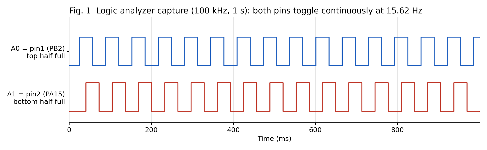
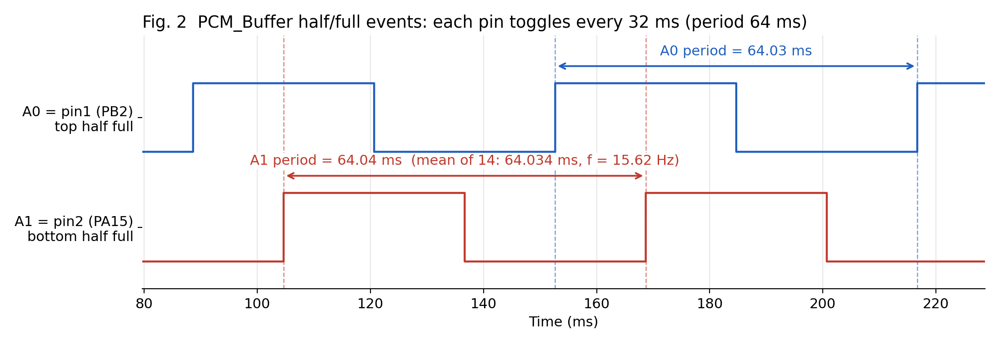
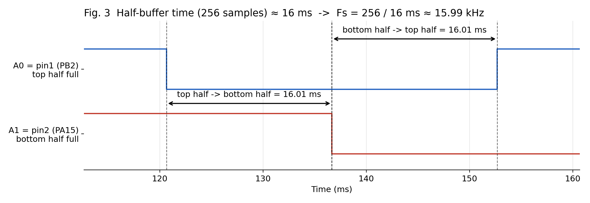

# Lab 6 Option Problem 1: Microphone DMA Sampling with CMSIS-RTOS

The measured audio sampling rate is **15,991.5 Hz**, within 0.05% of the designed 16 kHz. The microphone records continuously under CMSIS-RTOS (FreeRTOS), and a logic analyzer reads the rate from two GPIO pins that toggle on the DMA half-transfer and transfer-complete events.

- Board: B-L475E-IOT01A (STM32L475VG)
- Toolchain: STM32CubeIDE, STM32CubeMX, STM32Cube FW_L4 V1.18.2
- RTOS: FreeRTOS through CMSIS-RTOS v2
- Project: [`Mic_RTOS_Lab/`](Mic_RTOS_Lab)

## 1. Objective

The task was to port the Mbed OS microphone example ([janjongboom/b-l475e-iot01a-audio-mbed](https://github.com/janjongboom/b-l475e-iot01a-audio-mbed)) to STM32CubeIDE with CMSIS-RTOS and modify it as follows:

1. Record continuously and periodically instead of for two seconds. Audio data does not need to be stored or printed.
2. DMA moves audio samples into `PCM_Buffer`. When the top half fills, toggle pin 1. When the bottom half fills, toggle pin 2.
3. Connect both pins to a logic analyzer and derive the audio sampling frequency from the waveforms.

## 2. System Design

```
MP34DT01 (PDM mic) --PE7/PE9--> DFSDM1 Channel1 --> DFSDM1 Filter0 (Sinc3) --> DMA1 Channel4 (circular) --> PCM_Buffer[512]
                                                                                    |-- half transfer  -> toggle PB2  (pin 1)
                                                                                    '-- transfer cplt  -> toggle PA15 (pin 2)
```

1. **Microphone clock.** DFSDM CKOUT = SYSCLK / divider = 80 MHz / 40 = **2 MHz**, inside the MP34DT01 range of 1 to 3.25 MHz. CubeMX's default divider of 2 gives 40 MHz, which exceeds the microphone spec, so the code overrides it.
2. **Decimation.** Filter0 uses a Sinc3 filter with oversampling ratio FOSR = 125 and integrator ratio IOSR = 1, so Fs = 2 MHz / 125 = **16 kHz**.
3. **Continuous recording.** DMA1 Channel4 (request 0 = DFSDM1_FLT0) runs in **circular mode**. After the last element it wraps to the start of `PCM_Buffer` without software restarting it, so recording never stops.
4. **Double buffering.** `PCM_Buffer` holds 512 samples. The half-transfer interrupt fires after samples 0 to 255 are written, and the transfer-complete interrupt fires after samples 256 to 511.
5. **RTOS.** One CMSIS-RTOS thread, `AudioTask`, starts the DMA and then blocks on thread flags set by the two DMA callbacks. The GPIO toggles happen inside the callbacks so the pin timing is not affected by task scheduling.

Expected timing:

| Quantity | Formula | Value |
|---|---|---|
| Sampling rate Fs | 2 MHz / 125 | 16,000 Hz |
| Half-buffer time | 256 / Fs | 16 ms |
| Time between toggles of one pin | 512 / Fs | 32 ms |
| Square-wave period of one pin | 2 × 512 / Fs | 64 ms (15.625 Hz) |

## 3. Implementation

The project was generated by CubeMX from the board's default configuration, with FreeRTOS set to CMSIS_V2 and a single task `AudioTask`. All added code lives inside `USER CODE` blocks, so regenerating code from the `.ioc` keeps it.

| File | Change |
|---|---|
| `Core/Src/main.c` | DFSDM clock divider override, Filter0 init, DMA MSP, half/complete callbacks, `AudioTask` body |
| `Core/Src/stm32l4xx_it.c` | `DMA1_Channel4_IRQHandler` |
| `Mic_RTOS_Lab.ioc` | FreeRTOS reduced to one task, `AudioTask` |

**GPIO selection.** Pin 1 = **PB2 (Arduino D8)**, pin 2 = **PA15 (Arduino D9)**. Both are already push-pull outputs in the board's default pinout and sit next to each other on the CN1 header.

**DFSDM filter.**

```c
hdfsdm1_filter0.Instance                         = DFSDM1_Filter0;
hdfsdm1_filter0.Init.RegularParam.Trigger        = DFSDM_FILTER_SW_TRIGGER;
hdfsdm1_filter0.Init.RegularParam.FastMode       = ENABLE;
hdfsdm1_filter0.Init.RegularParam.DmaMode        = ENABLE;
hdfsdm1_filter0.Init.FilterParam.SincOrder       = DFSDM_FILTER_SINC3_ORDER;
hdfsdm1_filter0.Init.FilterParam.Oversampling    = 125;   /* 2 MHz / 125 = 16 kHz */
hdfsdm1_filter0.Init.FilterParam.IntOversampling = 1;
HAL_DFSDM_FilterInit(&hdfsdm1_filter0);
HAL_DFSDM_FilterConfigRegChannel(&hdfsdm1_filter0, DFSDM_CHANNEL_1, DFSDM_CONTINUOUS_CONV_ON);
```

**DMA in circular mode** (inside `HAL_DFSDM_FilterMspInit`):

```c
hdma_dfsdm1_flt0.Instance                 = DMA1_Channel4;
hdma_dfsdm1_flt0.Init.Request             = DMA_REQUEST_0;          /* DFSDM1_FLT0 */
hdma_dfsdm1_flt0.Init.Direction           = DMA_PERIPH_TO_MEMORY;
hdma_dfsdm1_flt0.Init.MemInc              = DMA_MINC_ENABLE;
hdma_dfsdm1_flt0.Init.PeriphDataAlignment = DMA_PDATAALIGN_WORD;
hdma_dfsdm1_flt0.Init.MemDataAlignment    = DMA_MDATAALIGN_WORD;
hdma_dfsdm1_flt0.Init.Mode                = DMA_CIRCULAR;
HAL_NVIC_SetPriority(DMA1_Channel4_IRQn, 5, 0);   /* = configLIBRARY_MAX_SYSCALL_INTERRUPT_PRIORITY */
```

The DMA interrupt priority is 5 so the callbacks can call `osThreadFlagsSet`. A priority numerically lower than 5 would break FreeRTOS API calls from the ISR.

**Callbacks that toggle the pins** (simplified excerpt).

```c
void HAL_DFSDM_FilterRegConvHalfCpltCallback(DFSDM_Filter_HandleTypeDef *hdfsdm_filter)
{
  HAL_GPIO_TogglePin(PIN1_GPIO_Port, PIN1_Pin);           /* top half of PCM_Buffer filled */
  osThreadFlagsSet(AudioTaskHandle, FLAG_HALF_FULL);
}

void HAL_DFSDM_FilterRegConvCpltCallback(DFSDM_Filter_HandleTypeDef *hdfsdm_filter)
{
  HAL_GPIO_TogglePin(PIN2_GPIO_Port, PIN2_Pin);           /* bottom half of PCM_Buffer filled */
  osThreadFlagsSet(AudioTaskHandle, FLAG_FULL);
}
```

**RTOS task.**

```c
void StartAudioTask(void *argument)
{
  HAL_DFSDM_FilterRegularStart_DMA(&hdfsdm1_filter0, PCM_Buffer, PCM_BUFFER_LEN);
  for (;;)
  {
    osThreadFlagsWait(FLAG_HALF_FULL | FLAG_FULL, osFlagsWaitAny, osWaitForever);
    /* Audio processing would go here; the lab does not require storing the data. */
  }
}
```

## 4. Experimental Setup

| Logic analyzer | Board | Signal |
|---|---|---|
| A0 | D8 (PB2) | Pin 1: top half filled |
| A1 | D9 (PA15) | Pin 2: bottom half filled |
| GND | GND | Common ground |

- Logic analyzer: ZEROPLUS LAP-C(16128)
- Software: PulseView 0.4.2 (sigrok)
- Capture: 100 kHz sample rate, 100k samples (1.0 s), 10 µs timing resolution
- Raw capture: [`image2.sr`](image2.sr)

## 5. Results



**Fig. 1** Full 1 s capture. Both pins toggle continuously, which confirms the circular DMA keeps recording without stopping.



**Fig. 2** Each pin has a period of about 64.03 ms, so each pin toggles once every 32 ms.



**Fig. 3** The top-half event and the bottom-half event alternate every 16.01 ms, which is the time to fill 256 samples.

Edge times were extracted from the raw capture and averaged over every edge (31 toggles on A0, 30 on A1):

| Quantity | Measured | Expected | Error |
|---|---|---|---|
| Pin period (A0 / A1) | 64.034 ms (std 0.005 ms) | 64 ms | +0.05% |
| Time between toggles of one pin (512 samples) | 32.017 ms | 32 ms | +0.05% |
| Top-half to bottom-half event (256 samples) | 16.01 ms | 16 ms | +0.06% |
| Pin frequency | 15.617 Hz | 15.625 Hz | -0.05% |
| **Sampling rate Fs = 512 / 32.017 ms** | **15,991.5 Hz** | 16,000 Hz | -0.05% |

## 6. Discussion

1. **Sampling rate.** The measured 15,991.5 Hz matches the design value of 2 MHz / 125 = 16 kHz to within 0.05%. This confirms that the DFSDM clock divider and filter oversampling ratio are configured as intended.
2. **Continuous, periodic execution.** Over 1 s the toggle interval varied by only 5 µs (standard deviation), which is below the analyzer's 10 µs resolution. The DMA interrupts are therefore strictly periodic and the program does not stop after a fixed recording time.
3. **Double buffering.** The two pins are offset by exactly half a buffer (16 ms). While DMA fills one half, software could safely process the other half, which is the purpose of splitting `PCM_Buffer` into top and bottom halves.
4. **Error sources.** The 0.05% offset is consistent with the tolerance of the MSI oscillator, which drives the 80 MHz PLL and is trimmed by the LSE, and with the analyzer's own time base. The 10 µs sample period limits a single-edge measurement to about ±0.03% of 32 ms, and averaging over all edges reduces this further.

## 7. Build and Run

1. In STM32CubeIDE, choose **File → Import → Existing Projects into Workspace** and select `Mic_RTOS_Lab/`.
2. Build and flash with **Run** or **Debug**.
3. Optional: in Debug mode, add `halfCpltCount` and `cpltCount` to **Live Expressions**. Both counters increase by about 31 per second while DMA is running.
